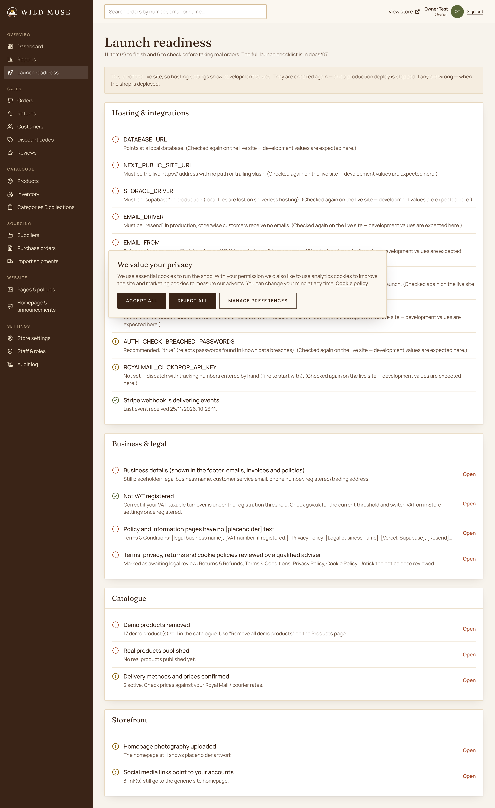

# WILD MUSE — Stage 7: Deployment, Backups, Operations & Launch

_Completed 25 November 2026. This is the final stage of the build. The shop is ready to deploy. The remaining steps
need accounts in **your** name (hosting, database, email, payments), which only you can create._

**Contents**
1. What's ready and what needs you
2. Running costs
3. Deploy step by step (Supabase → Resend → Stripe → Vercel → first owner → test → go live)
4. Environment variables reference
5. Backups and disaster recovery
6. Monitoring
7. Operations runbook (routine work and what to do when something goes wrong)
8. Launch checklist
9. Verification results for this stage

---

## 1. What's ready and what needs you

| Built and tested in this stage | Needs you |
|---|---|
| **Deploy safety gate**: a production build stops if any setting is missing or wrong (e.g. no webhook secret, emails set to "console") | Create Supabase, Resend, Stripe and Vercel accounts and paste their keys into Vercel |
| **Automatic database migrations** on every deploy (`vercel-build`) | Buy/point the domain |
| **Health endpoint** `/api/health` for uptime monitoring (503 if the database is down) | Sign up for a free uptime monitor |
| **Post-deploy smoke test**: `npm run smoke -- https://your-domain` (read-only, 25 checks) | Run it after each deploy |
| **Backup and restore scripts** with optional encryption, tested with a full restore | Run a monthly off-site backup |
| **Admin → Launch readiness** page listing everything unfinished (placeholders, demo products, test keys…) | Work through it until it's all ticked |
| **GitHub Actions CI**: lint, types, 46 tests against real Postgres, audit and build on every push | Nothing |
| London hosting region, connection pooling for serverless, style guide hidden on the live site | — |



## 2. Running costs (checked November 2026; confirm on each provider's pricing page)

| Service | Plan | Approx. cost | Why this plan |
|---|---|---|---|
| **Vercel** (hosting) | **Pro** | about $20/month per team member (one member is enough) | The free Hobby plan is **for non-commercial use only**, and its scheduled jobs run only **once a day**. The shop's stock-release job runs every 15 minutes. |
| **Supabase** (database + photo storage) | **Pro** | $25/month | The free plan **pauses after a week without activity** and has **no automatic backups**. Pro has daily backups kept for 7 days and no pausing. |
| **Resend** (email) | Free to start | £0 at low volume | The free tier covers a small shop's order emails. Check its daily and monthly limits and upgrade when you outgrow them. |
| **Stripe** (payments) | Pay per transaction | No monthly fee; a % + fixed fee per card payment (UK cards are cheapest) | See stripe.com/gb/pricing. Fees are shown per payment in your Stripe dashboard. |
| **Royal Mail Click & Drop** | Free account | £0 (you pay postage) | Optional. Without it, you type tracking numbers in by hand. |
| **Domain** (e.g. `.co.uk`) | Any registrar | about £10–20/year | — |
| Uptime monitor | Free tier (e.g. UptimeRobot, Better Stack) | £0 | — |

**Total fixed cost: about £40/month plus a domain**, before payment fees and postage.

## 3. Deploy step by step

Do this once, in order. It takes about 1–2 hours. Turn on **two-factor authentication** on every account as you
create it, and create every account in the business's name and email, not a developer's.

### Step A — Supabase (database and photo storage)
1. Go to supabase.com and create an organisation, upgrade it to **Pro**, then create a new project:
   - **Region:** London (`eu-west-2`). It's close to the hosting, and customer data stays in the UK.
   - **Database password:** use a long random password and keep it in a password manager.
2. **Project Settings → Database → Connection string**:
   - **Transaction pooler** string (port **6543**) → this is `DATABASE_URL`.
   - **Session pooler / direct** string (port **5432**) → this is `DIRECT_URL`. It's used for migrations and backups.
3. **Storage → New bucket**:
   - `media`, set to **Public** (product photos)
   - `private`, left **private** (supplier invoices, customs documents)
4. **Project Settings → API**: copy the **Project URL** (`SUPABASE_URL`) and the **service_role** key
   (`SUPABASE_SERVICE_ROLE_KEY`). The service_role key is all-powerful. It goes only into Vercel, never into code or chat.
5. Security note: every shop table has Row Level Security switched on with no public policies. Supabase's automatic
   public API therefore can't read shop data. Only the app's server connection can.

### Step B — Load the starter data (from your computer, once)
```bash
git clone https://github.com/namitpoudel/wild-muse.git && cd wild-muse && npm ci
```
```bash
DATABASE_URL="<DIRECT_URL from step A>" npx prisma migrate deploy
```
```bash
DATABASE_URL="<DIRECT_URL from step A>" SEED_DEMO=false npm run db:seed
```
This creates categories, delivery methods, tax classes and the policy pages, **without** demo products.
(Use `SEED_DEMO=true` if you'd like to see the demo catalogue first. It can be removed later from Admin → Products.)

### Step C — Resend (order emails)
1. Sign up at resend.com, then go to **Domains → Add domain** and enter your shop domain.
2. Add the DNS records it shows (SPF, DKIM, and the recommended DMARC) at your domain registrar. Wait until Resend says **Verified**.
3. **API Keys → Create** with **Sending access** only → `RESEND_API_KEY`.
4. Choose your sender, e.g. `EMAIL_FROM="Wild Muse <hello@yourdomain.co.uk>"`.

### Step D — Stripe (payments): test mode first
1. stripe.com → activate your account: business details, bank account for payouts, and statement descriptor (`WILD MUSE`).
2. **Settings → Branding**: logo and colours (Stripe's checkout page uses them).
3. **Settings → Payment methods**: cards are on by default. Apple Pay and Google Pay work automatically on Checkout.
   Optional: Klarna / PayPal.
4. Stay in **test mode** for now. **Developers → API keys** → copy the **Secret key** (`sk_test_…`) → `STRIPE_SECRET_KEY`.
5. **Developers → Webhooks → Add endpoint**:
   - URL: `https://<your-domain>/api/webhooks/stripe`
   - Events: `checkout.session.completed`, `checkout.session.async_payment_succeeded`, `checkout.session.async_payment_failed`,
     `checkout.session.expired`, `refund.created`, `refund.updated`, `refund.failed`, `charge.dispute.created`
   - Copy its **Signing secret** (`whsec_…`) → `STRIPE_WEBHOOK_SECRET`.

### Step E — Vercel (hosting)
1. vercel.com → sign up with GitHub, then upgrade the team to **Pro**.
2. **Add New → Project → Import** `namitpoudel/wild-muse`. The framework is detected as Next.js. Leave the build command
   alone: Vercel automatically runs the `vercel-build` script, which does the configuration check, then migrations, then the build.
3. **Settings → Environment Variables**: add every variable from section 4 for **Production**. Tick **Sensitive** for secrets.
   For Preview deployments, use test keys and ideally a separate Supabase project. Never point previews at the live database.
4. **Settings → Domains**: add `yourdomain.co.uk` and `www.yourdomain.co.uk` and follow the DNS instructions. HTTPS is automatic.
5. **Deploy.** If the configuration check fails, the build log lists exactly which variables to fix.
6. The scheduled job (`vercel.json`, every 15 minutes) is picked up automatically. Vercel sends your `CRON_SECRET` with it.

### Step F — Create the owner account
1. Register on the live site at `https://<your-domain>/register` and verify the email.
2. From your computer, give that account the Owner role:
```bash
DATABASE_URL="<DIRECT_URL>" npm run admin:create -- you@yourdomain.co.uk
```
3. Sign in and open **Admin → Launch readiness**.

### Step G — Test everything in test mode
1. Run the smoke test: it should report "All checks passed".
```bash
npm run smoke -- https://yourdomain.co.uk
```
2. Buy something with test card `4242 4242 4242 4242` (any future expiry date, any CVC). Check that:
   - the order shows as **Paid** in Admin
   - the confirmation email arrives (check the spam folder too)
   - the shop alert email arrives
   - Stripe → Webhooks shows a successful (200) delivery.
3. Refund it from Admin → Order → Refund. Check that the refund email arrives and the order shows Refunded.
4. Try card `4000 0000 0000 9995` (declined): no order should be marked paid, and the stock should be released.
5. Dispatch a test order with a tracking number and check the dispatch email.
6. Submit a return from the customer account and approve it in Admin → Returns.

### Step H — Go live
1. Work through **Admin → Launch readiness** until nothing is "To do".
2. In Stripe, switch to **live mode**:
   - copy the live secret key (`sk_live_…`, or better a restricted `rk_live_` key with Checkout Sessions, Coupons and
     Refunds write access)
   - create the **same webhook endpoint again in live mode**; it has a different `whsec_` secret.
3. In Vercel, replace `STRIPE_SECRET_KEY` and `STRIPE_WEBHOOK_SECRET` with the live values, then **Redeploy**.
4. Make one real, low-value purchase with your own card, check it end to end, and refund it.
5. Submit `https://yourdomain.co.uk/sitemap.xml` in Google Search Console.

**Rolling back:** Vercel → Deployments → pick the previous good deployment → **Instant Rollback** (takes seconds).
Database migrations only move forward. Undoing a data change means restoring a backup (section 5).

## 4. Environment variables reference

| Variable | Value | Secret? |
|---|---|---|
| `DATABASE_URL` | Supabase transaction pooler string (port 6543) | yes |
| `DIRECT_URL` | Supabase session/direct string (port 5432), for migrations | yes |
| `NEXT_PUBLIC_SITE_URL` | `https://yourdomain.co.uk` (no trailing slash) | no |
| `BETTER_AUTH_URL` | same as `NEXT_PUBLIC_SITE_URL` | no |
| `BETTER_AUTH_SECRET` | output of `openssl rand -base64 32` | yes |
| `AUTH_CHECK_BREACHED_PASSWORDS` | `true` | no |
| `STORAGE_DRIVER` | `supabase` | no |
| `SUPABASE_URL` | `https://<project>.supabase.co` | no |
| `SUPABASE_SERVICE_ROLE_KEY` | service_role key | **yes** |
| `SUPABASE_PUBLIC_BUCKET` / `SUPABASE_PRIVATE_BUCKET` | `media` / `private` | no |
| `EMAIL_DRIVER` | `resend` | no |
| `RESEND_API_KEY` | `re_…` | yes |
| `EMAIL_FROM` | `Wild Muse <hello@yourdomain.co.uk>` | no |
| `STRIPE_SECRET_KEY` | `sk_test_…`, then `sk_live_…` / `rk_live_…` | **yes** |
| `STRIPE_WEBHOOK_SECRET` | `whsec_…` for the matching mode | yes |
| `CRON_SECRET` | output of `openssl rand -hex 32` | yes |
| `ROYALMAIL_CLICKDROP_API_KEY` | optional | yes |
| `NEXT_PUBLIC_GA4_ID`, `NEXT_PUBLIC_META_PIXEL_ID`, `NEXT_PUBLIC_TIKTOK_PIXEL_ID` | optional; these load only after cookie consent | no |
| `DATABASE_POOL_MAX` | optional, default 5 connections per server instance | no |

Never put secrets in variables starting with `NEXT_PUBLIC_`, because those are visible in the browser. `npm run check:env`
checks the current settings at any time.

## 5. Backups and disaster recovery

| Layer | What protects it | Retention |
|---|---|---|
| Database (orders, customers, products, stock) | Supabase Pro **automatic daily backups** | 7 days (Point-in-Time Recovery is a paid add-on if you need minute-level recovery) |
| Database, off-site copy | **Monthly** encrypted backup with `npm run db:backup` (below), stored somewhere other than Supabase | your choice (keep 12 months) |
| Product photos and documents (Supabase Storage) | **Not included in database backups.** Keep your original photos in your own cloud drive. Keep supplier and customs documents there too, since HMRC requires records to be kept for 6 years | — |
| Code | GitHub (and every Vercel deployment can be rolled back) | permanent |
| Payments | Stripe holds the authoritative payment and refund records | permanent |

**Monthly off-site backup** (from your computer; needs PostgreSQL client tools of the same or newer major version as Supabase):
```bash
BACKUP_DATABASE_URL="<DIRECT_URL>" BACKUP_PASSPHRASE="<long passphrase from your password manager>" npm run db:backup
```
This creates `backups/wildmuse-<date>.dump.gpg`, encrypted with AES-256. It contains customers' personal data, so store it
encrypted (as made) and never commit it. The `backups/` folder is ignored by git.

**Restore** (practise once a year on a spare Supabase project, not the live one):
```bash
npm run db:restore -- backups/wildmuse-<date>.dump.gpg "<target database URL>"
```
It asks you to type the database host name before replacing anything.

**If the live database is lost or corrupted:**
1. Put the shop in maintenance: in Vercel, roll back to a deployment, or temporarily remove the domain.
2. Restore the most recent Supabase daily backup (Supabase → Database → Backups), or use your off-site dump.
3. Compare with Stripe: any order paid after the backup time will be missing. Run **Admin → Orders → Check payment with
   Stripe** where possible, or re-create the orders from the Stripe payment list.
4. Run the smoke test, then reopen.

**Tested in this stage:** backup → encrypt → decrypt → restore into an empty database. The restored copy was identical
to the original: 25 orders, 18 products, 17 users, 217 stock movements, the same total money value, all 98 indexes,
all 14 data-integrity rules and row-level security on all 43 tables. Migrations reported "up to date" and the order
integration tests passed against the restored copy.

## 6. Monitoring

| What | How |
|---|---|
| Site up / database up | Point a free uptime monitor at `https://yourdomain.co.uk/api/health` every 5 minutes, with email/SMS alerts. It returns **503** if the database is down, and reports `"status":"degraded"` if a setting is missing. Tested: 503 during a simulated database outage, recovering by itself. Cached shop pages kept loading during the outage. |
| Payments being confirmed | Stripe → Developers → Webhooks shows delivery failures, and Stripe emails you if deliveries keep failing. The 15-minute job also re-checks pending orders directly with Stripe. |
| Errors | Vercel → Project → Logs (search for `[stripe webhook]`, `[checkout]`, `[email]`). Optional: an error-tracking service such as Sentry (free tier) can be added later. It isn't installed, because it would send error data to a third party, which needs a privacy-policy mention. |
| Emails | Resend → Logs shows every message with delivered/bounced status. |
| Admin activity | Admin → Audit log |

## 7. Operations runbook

**Daily**
- Admin → Dashboard: new paid orders → pack → **Dispatch** with tracking (or Send to Click & Drop → buy label → Sync).
- Admin → Returns: reply within 1 working day; refund within 14 days of receiving the items.
- Admin → Reviews: moderate new reviews.

**Weekly**
- Admin → Inventory: low-stock list, then raise purchase orders with suppliers.
- Stripe → Payouts: reconcile with Admin → Reports.

**Monthly**
- Off-site encrypted backup (section 5).
- Check for software updates. Dependabot can be enabled in GitHub → Settings → Code security. CI must pass before merging.
- Admin → Reports: gross margin per product.

**When something goes wrong**

| Symptom | Likely cause → fix |
|---|---|
| Customer paid but the order still shows "Awaiting payment" | The webhook isn't reaching the site. Check Stripe → Webhooks (wrong URL? the test-mode secret on the live site?). Click **Check payment with Stripe** on the order. Fix `STRIPE_WEBHOOK_SECRET`, then redeploy. |
| Checkout says "couldn't connect to our payment provider" | Stripe key wrong or revoked. Check `STRIPE_SECRET_KEY` in Vercel. The customer's bag is kept. |
| No emails arriving | Resend → Logs. Check the domain is still verified, `EMAIL_DRIVER=resend`, and the API key hasn't been revoked. |
| Items stuck as "reserved" | The scheduled job isn't running: Vercel → Cron Jobs (needs the Pro plan and `CRON_SECRET`). |
| Site down | Check `/api/health` and Vercel status. If a bad deploy caused it, use **Instant Rollback**. |
| Chargeback / dispute | A note is added to the order automatically. Respond with evidence (tracking, delivery proof) in Stripe → Disputes before the deadline. |
| Customer asks for their data or for deletion (UK GDPR) | Respond within one month. Customers can export or delete their data themselves in Account → Privacy. For guest orders, export the order from Admin. Order records needed for tax are kept (6 years). |
| Suspected data breach | Contain it: revoke keys, rotate `BETTER_AUTH_SECRET` (this signs everyone out), check the Audit log. If personal data is at risk, report it to the **ICO within 72 hours** and inform affected customers if the risk is high. |
| Lost access to the owner account | Reset the password by email. Otherwise run `npm run admin:create -- <email>` against the database to promote another account. |

## 8. Launch checklist

**Business and legal (UK)**
- [ ] Trading structure decided (sole trader or limited company) and registered with HMRC / Companies House
- [ ] **ICO data protection fee** paid. Most businesses that process customer data must pay it; check the current tier on ico.org.uk.
- [ ] Business details entered in Admin → Store settings: legal name, address, email, phone, company number
- [ ] Terms, Privacy, Cookies, Returns and Delivery pages completed (no [placeholders]) and **reviewed by a qualified adviser**; the "awaiting legal review" notices then switched off
- [ ] VAT: not registered until taxable turnover approaches the threshold (check gov.uk). Register and switch VAT on in settings when needed.
- [ ] Product liability insurance
- [ ] Product compliance for each item:
  - fibre composition on textile labels (Textile Products (Labelling and Fibre Names) Regulations)
  - nickel/lead limits for jewellery (UK REACH)
  - care labels
  - country of origin "Made in Nepal"
  - tick "labelling & safety checked" in each product before publishing
- [ ] Import records (C79 import VAT certificates, commercial invoices, origin statements) uploaded per shipment in Admin
- [ ] Artisan photos and stories published only with written consent (enforced by the admin)

**Catalogue and content**
- [ ] Demo products removed; real products with photos, alt text, sizes, measurements, materials and care
- [ ] Delivery prices checked against your actual postage costs
- [ ] Homepage images, announcement bar, social media links
- [ ] Returns address and instructions in the Returns policy and return-approval email (from business details)

**Technical** (most of this is checked automatically by Launch readiness and the smoke test)
- [ ] All section 4 variables set; deploy check passes
- [ ] Test-mode purchase, refund, decline, dispatch and return tested (step G)
- [ ] Live Stripe keys and live webhook; one real purchase + refund
- [ ] `npm run smoke -- https://yourdomain.co.uk` passes
- [ ] Uptime monitor on `/api/health`
- [ ] Two-factor authentication on GitHub, Vercel, Supabase, Stripe, Resend, the domain registrar and email
- [ ] Rotate any key that has ever been pasted into a chat or email (including the Stripe **test** key shared during this build: Stripe → API keys → Roll key)
- [ ] Re-run Lighthouse on the live domain after real photos are uploaded
- [ ] Quick manual screen-reader check: VoiceOver on iPhone (product → bag → checkout)
- [ ] Google Search Console: verify domain, submit sitemap. Optional: Google Merchant Center product feed.

## 9. Verification results (Stage 7)

| Check | Result |
|---|---|
| typecheck, lint, Prettier | ✔ clean |
| Unit + integration tests | ✔ **46/46** (new: production configuration check ×5, placeholder detection ×2) |
| CI simulated on a brand-new empty database (migrate → seed → format → tests → contrast → audit) | ✔ all steps pass |
| Deploy gate | ✔ blocks a production build with missing settings (exit 1); preview builds continue; a complete configuration passes |
| Backup → encrypt → restore → compare | ✔ identical (see section 5) |
| Health endpoint | ✔ 200 when healthy, **503** when the database is stopped, recovers automatically |
| Smoke test against the production build | ✔ **25/25** |
| End-to-end browser suite | ✔ **54/54** |
| Accessibility audit (now 65 pages, including Launch readiness) | ✔ 0 violations |
| `npm audit` | ✔ 0 vulnerabilities |

**Not verified (requires your accounts):**
- the real Vercel deployment and the Supabase pooler connection
- Supabase Storage uploads
- live Resend delivery
- a live Stripe Checkout payment and refund (the Stripe key saved in this build environment was invalid; it starts with "Namit")
- Royal Mail Click & Drop

Step G is written so you can verify each of these yourself in about 20 minutes once the accounts exist.
